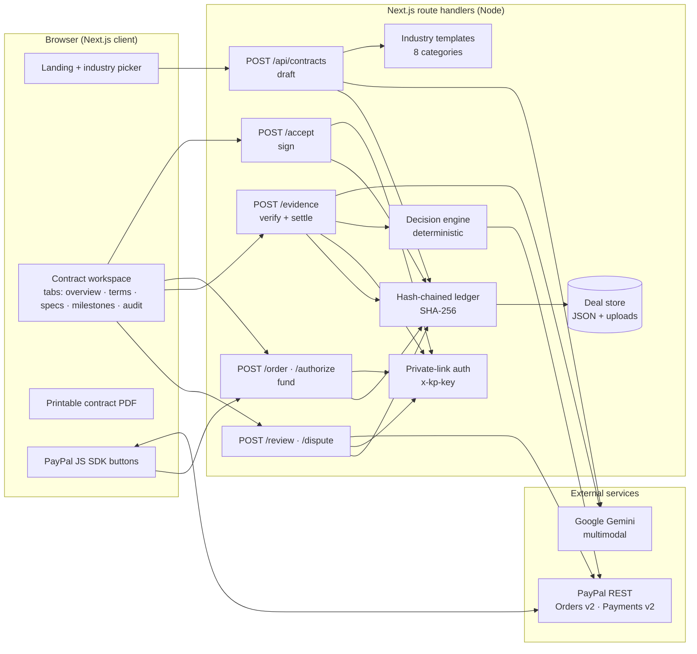
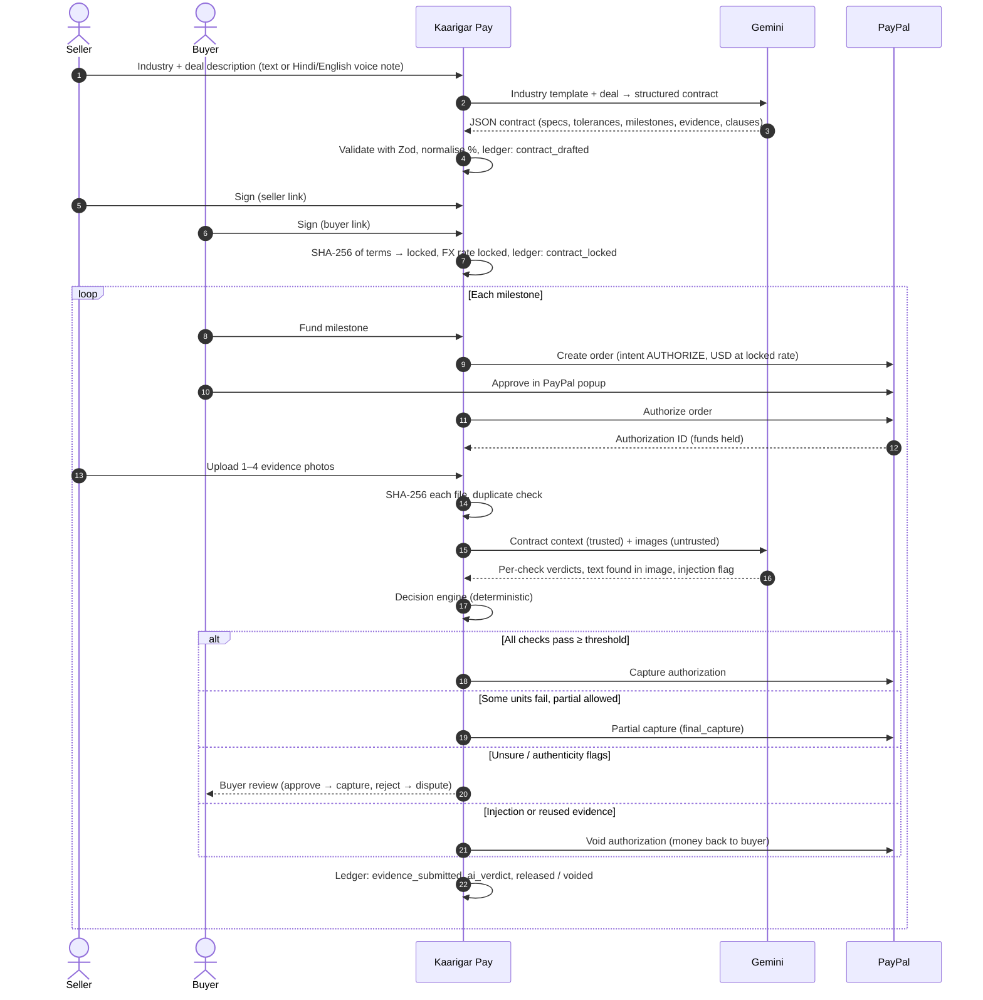
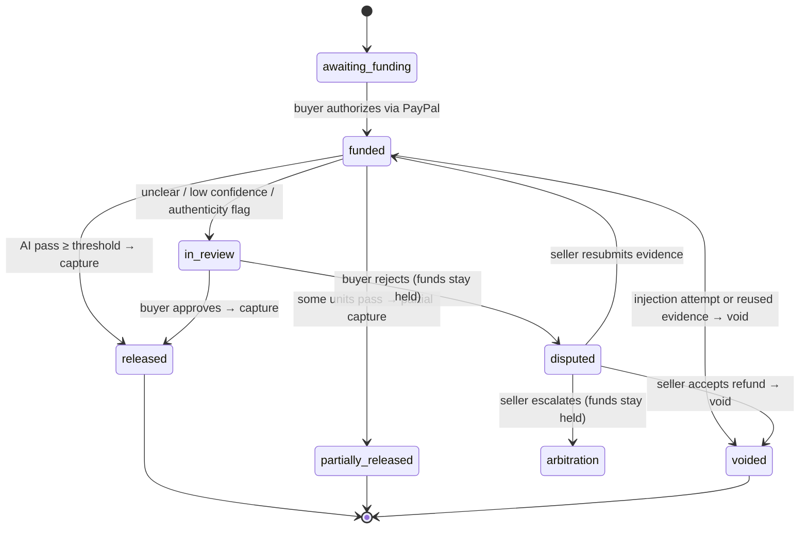
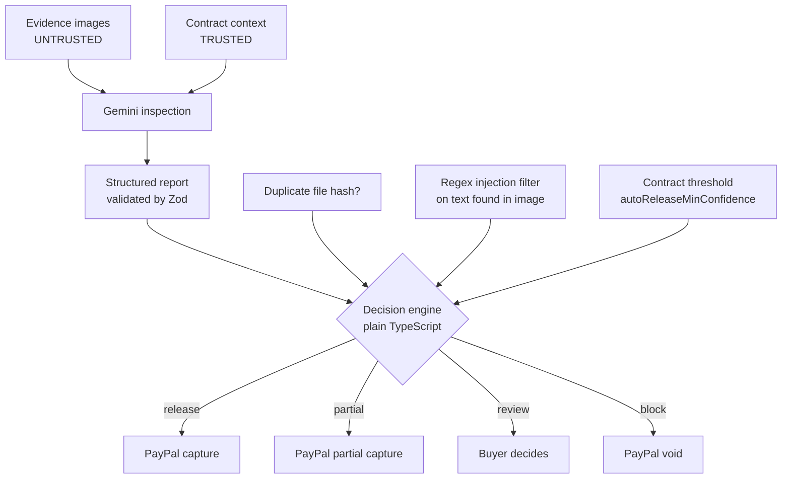
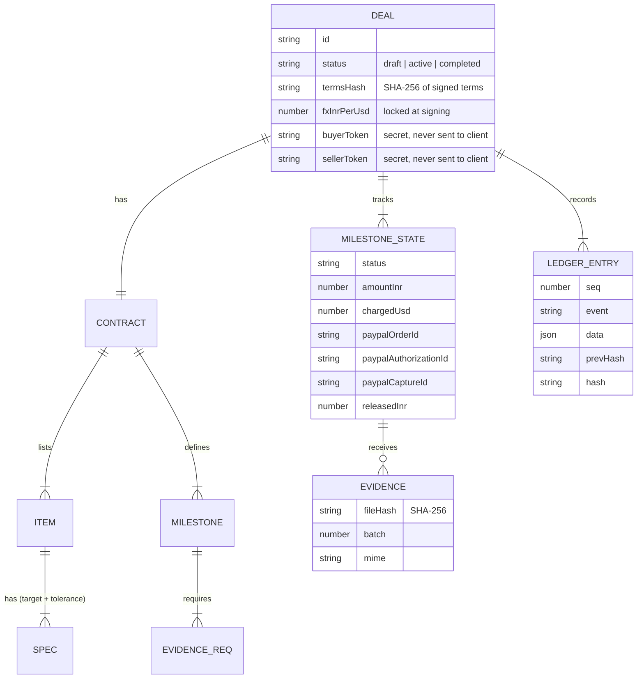

# Architecture

Kaarigar Pay is a single Next.js application (App Router, TypeScript) that combines three things:

1. **PayPal** as the money rail: funds are *authorized* (held) per milestone and later *captured*, *partially captured* or *voided*.
2. **Google Gemini** as the AI layer: it drafts structured contracts and inspects evidence photos.
3. **A deterministic rule engine and a hash-chained ledger** that sit between the two, so the AI never moves money by itself.

---

## 1. System overview

| Layer | Responsibility | Code |
|---|---|---|
| Industry templates | Standard payment splits, evidence, inspection norms, Incoterms for 8 industries | `src/lib/categories.ts` |
| Contract schema | Zod schema for the machine-enforceable contract; normalisation of milestone % | `src/lib/contract.ts` |
| AI drafting & verification | Prompts, multimodal calls, output validation, retry and fallback models | `src/lib/verify.ts`, `src/lib/gemini.ts` |
| Decision engine | Turns the AI report into release / partial release / review / block | `decide()` in `src/lib/verify.ts` |
| Money movement | PayPal OAuth, AUTHORIZE orders, capture, partial capture, void | `src/lib/paypal.ts`, `src/lib/settle.ts` |
| Access control | Private buyer/seller tokens; secrets stripped from responses | `src/lib/auth.ts` |
| Audit | Append-only SHA-256 hash chain + verification | `src/lib/ledger.ts` |
| Persistence | Serialised JSON store and evidence files | `src/lib/store.ts` |

---

## 2. End-to-end flow

---

## 3. Milestone state machine

A contract is `completed` when every milestone is `released`, `partially_released` or `voided`.

---

## 4. Why the AI can't move money

- The model only **reports**. It has no tool access and cannot call PayPal.
- Images are marked as untrusted in the prompt; any text inside them is copied out as data.
- A **second, model-independent filter** scans that text for instruction-like patterns, so a jailbroken or mistaken model still can't release funds.
- Thresholds come from the signed contract, not from the model.

---

## 5. Data model

---

## 6. PayPal integration

| Step | API | Notes |
|---|---|---|
| OAuth | `POST /v1/oauth2/token` | Client-credentials token, cached until expiry |
| Fund milestone | `POST /v2/checkout/orders` with `intent: AUTHORIZE` | One order per milestone; amount = milestone ₹ ÷ locked rate |
| Buyer approval | PayPal JS SDK `PayPalButtons` | Sandbox buyer logs in through the popup |
| Hold funds | `POST /v2/checkout/orders/{id}/authorize` | Returns the authorization ID stored on the milestone |
| Release | `POST /v2/payments/authorizations/{id}/capture` | Full capture |
| Partial release | same, with `amount` + `final_capture: true` | Pays only for units that pass; remainder is released back |
| Refund before capture | `POST /v2/payments/authorizations/{id}/void` | Used for blocked evidence and accepted refunds |

**Currency.** Contracts are denominated in INR. Indian PayPal accounts send and receive international payments in USD, so the INR→USD rate is fixed at signing and recorded in the ledger; only the PayPal order is in USD.

---

## 7. AI integration

| Task | Input | Output (validated) |
|---|---|---|
| Draft contract | Industry template + deal text and/or audio (Hindi/English) | `ContractSchema`: parties, items, specs with tolerances, milestones with evidence and checks, terms, governing law, arbitration |
| Verify evidence | Trusted contract context + 1–4 untrusted images | `VerificationSchema`: per-check pass/fail/unclear with confidence and observation, units passing, text found in image, injection flag, authenticity concerns |

Reliability: JSON-only responses, Zod validation with one automatic repair attempt for drafts, retries with exponential backoff on 429/500/503, and an ordered list of fallback models (`GEMINI_FALLBACK_MODELS`).

---

## 8. Security model

| Threat | Mitigation |
|---|---|
| Seller approves their own payment | Private-link tokens: buyer-only actions (fund, review) and seller-only actions (evidence, dispute) are checked server-side |
| Tokens leaking to the browser | `publicDeal()` strips tokens from every response |
| Prompt injection inside a photo | Untrusted-data prompt + model-reported `injectionAttempt` + independent regex filter → void |
| Reusing an old photo | SHA-256 of every file checked against all previous evidence |
| Editing history after the fact | Hash-chained ledger; `verifyChain()` reports the first broken entry, shown in the UI |
| Changing terms after signing | Terms hashed at signing; edits are rejected once the contract is active |
| AI hallucinating a pass | Release requires *every* check to pass *and* confidence ≥ the contract's threshold; otherwise a human decides |
