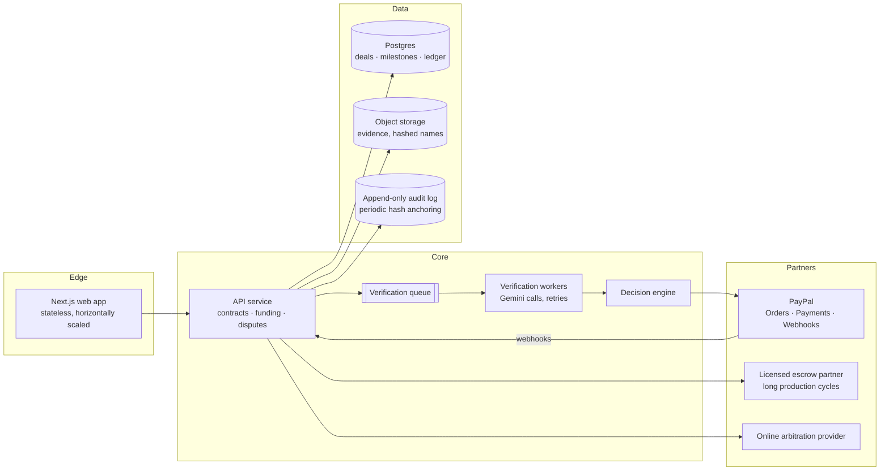

# Scalability and roadmap

The prototype is intentionally simple (one Next.js service, a JSON store) so it can be run by anyone in minutes. Every component has a clear production replacement, and none of them requires redesigning the flow.

## From prototype to production

| Concern | Prototype | Production |
|---|---|---|
| Storage | JSON file + local uploads | Postgres for deals and ledger; object storage (S3-compatible) for evidence, keyed by SHA-256 |
| Verification | Inline in the upload request | Queue + workers, so uploads return instantly and AI load is smoothed; per-tenant rate limits |
| AI availability | Retries + fallback models | Same, plus model routing by industry and a cached "known-good" verdict per file hash |
| Payment state | Updated from API responses | Also driven by PayPal webhooks, with idempotency keys on every capture/void |
| Long milestones | Per-milestone authorization (holds expire within days) | PayPal **reauthorization** for short gaps; licensed escrow partner for multi-week cycles, PayPal as the rail |
| Identity | Private-link tokens | Verified business accounts, PayPal login for buyers, KYC for sellers |
| Evidence authenticity | Hash duplicate check, camera-first upload | Device attestation, EXIF/time/location checks, perceptual hashing against the web |
| Audit | Hash chain per deal | Same, plus periodic anchoring of chain heads to an external timestamping service |
| Languages | Hindi/English voice → English contract | All scheduled Indian languages; buyer-side translation |
| Disputes | Escalation recorded | Integration with an online arbitration provider; evidence bundle exported automatically |

## Load characteristics
- **The expensive step is AI verification**, which happens once per evidence submission (a few times per milestone), not per page view. A queue lets it scale independently of web traffic.
- **PayPal calls are few and bounded:** one order, one authorization and one capture or void per milestone.
- **The web tier is stateless:** party identity is in the link token and all state is in the database, so it scales horizontally behind a load balancer.

## Product roadmap
1. **WhatsApp proof upload** for artisans who don't use web apps.
2. **More industries and countries**: templates are data (`src/lib/categories.ts`), so adding a new industry is a configuration change.
3. **Reputation from verified history**: completed milestones and dispute outcomes become a trust score that can unlock lower holds for repeat partners.
4. **Working-capital advances** against funded-but-unreleased milestones, once there's a history of verified deliveries.
